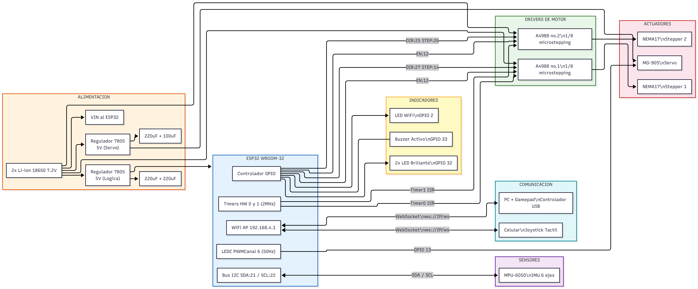
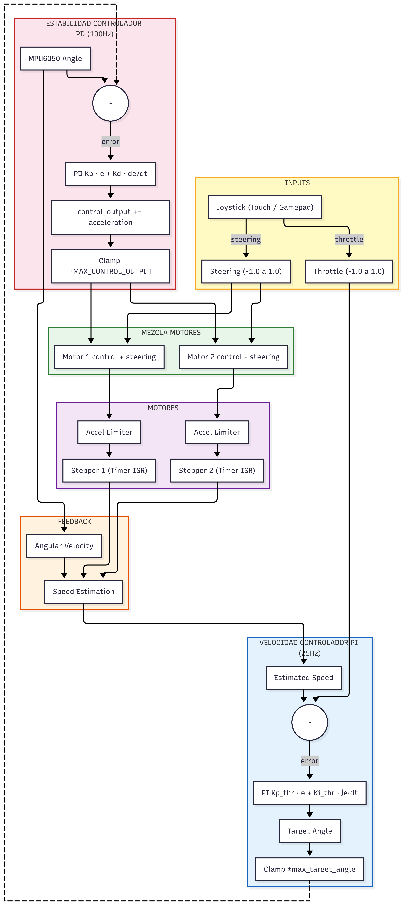

# ESP32 Robot Balanceador — CODAPLI

> Réplica del proyecto [ESP32 Balancing Robot Shield de PCBWay](https://www.pcbway.com/project/shareproject/ESP32_Balancing_Robot_Shield.html), adaptado y documentado para contexto académico en el marco del proyecto final para la materia de Tecnologias para la Automatización y de la mano con el laboratorio CODAPLI.

> **Industria 4.0 (UTN FRLP, 2026):** el robot se extendió con autenticación del WebSocket,
> telemetría hacia una plataforma IIoT local (Node-RED + InfluxDB + Grafana) y un gemelo digital
> con visor 3D en vivo. Ver [docs/ind40/README.md](docs/ind40/README.md).

## Descripción

Robot balanceador de dos ruedas basado en ESP32. Utiliza un sensor IMU MPU-6050 para estimar el ángulo de inclinación y un sistema de control en cascada (PID) para mantener el equilibrio mediante dos motores paso a paso NEMA17.

El robot se controla en tiempo real a través de una interfaz web embebida, accesible por WiFi desde cualquier navegador, sin necesidad de instalar aplicaciones. Soporta control táctil (joystick virtual), control mediante gamepad USB y ajuste de parámetros PID en tiempo real.

## Estructura del repositorio

| Carpeta                       | Contenido                                                                  |
| ----------------------------- | -------------------------------------------------------------------------- |
| `esp32_balancing_robot/`      | Firmware del robot (sketch de Arduino IDE)                                 |
| `iiot/`                       | Plataforma IIoT local: Node-RED + InfluxDB + Grafana con `docker compose`  |
| `gemelo-digital/`             | Gemelo digital: parser de telemetría, modelo (en desarrollo) y visor 3D    |
| `herramientas/diagnostico/`   | Sketch aparte para probar MPU-6050, motores, LEDs, buzzer y WiFi           |
| `docs/ind40/`                 | Hoja de ruta, decisiones y protocolo WebSocket del trabajo de Industria 4.0 |
| `docs/`, `figs/`              | Documentación, diagramas y modelos 3D del proyecto original                |

## Hardware

### Lista de componentes (BOM)

| Componente           | Especificación                       | Cantidad |
| -------------------- | ------------------------------------ | -------- |
| Microcontrolador     | ESP32 (ESP-WROOM-32)                 | 1        |
| Motor paso a paso    | NEMA17                               | 2        |
| Driver de motor      | A4988                                | 2        |
| IMU                  | MPU-6050 (giroscopio + acelerómetro) | 1        |
| Batería              | Li-ion 18650 3.7V                    | 2        |
| Buzzer               | Activo                               | 1        |
| LED                  | Alta luminosidad                     | 2        |
| Regulador de voltaje | LM7805                               | 2        |
| Capacitor            | 220µF / 16V                          | 2        |
| Capacitor            | 100µF / 16V                          | 1        |

### Pinout ESP32

| Pin ESP32 | Función                           |
| --------- | --------------------------------- |
| GPIO 12   | ENABLE motores (compartido A4988) |
| GPIO 14   | STEP motor 1                      |
| GPIO 27   | DIR motor 1                       |
| GPIO 26   | STEP motor 2                      |
| GPIO 25   | DIR motor 2                       |
| GPIO 21   | I2C SDA (MPU-6050)                |
| GPIO 22   | I2C SCL (MPU-6050)                |
| GPIO 32   | LED                               |
| GPIO 2    | LED WiFi (onboard)                |
| GPIO 33   | Buzzer                            |



## Arquitectura del Firmware

El firmware implementa un **sistema de control en cascada** corriendo a 100Hz:



### Módulos principales

| Archivo                     | Descripción                                                       |
| --------------------------- | ----------------------------------------------------------------- |
| `esp32_balancing_robot.ino` | Setup, loop principal, WiFi AP/AP+STA, WebSocket con autenticación y telemetría |
| `Control.cpp / .h`          | Controladores PD de estabilidad, PI de velocidad y PD de posición |
| `MPU6050.cpp / .h`          | Driver IMU: lectura I2C, filtro complementario, calibración       |
| `Motors.cpp / .h`           | Control de velocidad de motores con limitación de aceleración     |
| `Timers.cpp / .h`           | ISRs de hardware para generación de pulsos de paso                |
| `WebInterface.h`            | Interfaz web embebida (HTML/CSS/JS en PROGMEM)                    |
| `defines.h`                 | Pines, constantes, parámetros PID, macros de compatibilidad       |
| `globals.h / .cpp`          | Variables globales compartidas entre módulos                      |
| `secrets.example.h`         | Plantilla de `secrets.h` (contraseña del AP, token, red opcional) |
| `secrets_check.h`           | Impide compilar si falta `secrets.h` o quedaron valores de ejemplo |

### Filtro complementario (IMU)

El MPU-6050 fusiona giroscopio y acelerómetro mediante un filtro complementario:

```cpp
angle = 0.99 * (angle + gyro_rate * dt) + 0.01 * accel_angle
```

Esto combina la precisión a corto plazo del giroscopio con la estabilidad a largo plazo del acelerómetro, con una constante de tiempo de ~1 segundo a 100Hz.

### Compatibilidad ESP32 Arduino Core

El código soporta automáticamente **Core 2.x y Core 3.x** mediante macros de compatibilidad definidas en `defines.h`. Las APIs de timers y LEDC cambiaron significativamente entre versiones.

## Dependencias

Instalar desde el **Gestor de Librerías** de Arduino IDE:

| Librería            | Versión recomendada | Uso                      |
| ------------------- | ------------------- | ------------------------ |
| `Async TCP` (ESP32Async)          | Última           | TCP asíncrono para ESP32 |
| `ESP Async WebServer` (ESP32Async) | Última           | Servidor web y WebSocket |

La librería `Wire` (I2C) es parte del core de Arduino y no requiere instalación separada.

En el Gestor de Placas de Arduino IDE, instalar: [ESP32 by Espressif Systems](https://raw.githubusercontent.com/espressif/arduino-esp32/gh-pages/package_esp32_index.json) (probado con la versión 3.3.x)

## Instalación y Carga

1. Clonar el repositorio:

   ```bash
   git clone https://github.com/SerraFacundo/CODAPLI-esp32-balancing-robot.git
   ```

2. Copiar `esp32_balancing_robot/secrets.example.h` como `esp32_balancing_robot/secrets.h` y completar la contraseña del AP, el token del WebSocket y (opcional) la red WiFi de la laptop. Sin este archivo, o con los valores de ejemplo, el firmware no compila.

3. Abrir `esp32_balancing_robot/esp32_balancing_robot.ino` en Arduino IDE.

4. Seleccionar la placa: **Tools → Board → ESP32 Dev Module**

5. Configurar:
   - Upload Speed: `115200`
   - CPU Frequency: `240MHz`
   - Partition Scheme: `Default`

6. Conectar el ESP32 por USB y cargar el firmware con el botón **Upload**.

7. Abrir el Monitor Serie a `115200 baud` para ver el proceso de calibración, la IP del AP y, si se configuró la red de la laptop, la IP del robot en esa red.

## Uso

1. Encender el robot. El ESP32 creará una red WiFi:
   - **SSID:** `BalanceBot`
   - **Contraseña:** la definida en `esp32_balancing_robot/secrets.h` (`SECRET_AP_PASSWORD`)

2. Conectarse a esa red desde el celular o PC.

3. Abrir el navegador en: **http://192.168.4.1**. La página pide el token del robot (`SECRET_WS_TOKEN`) la primera vez y lo recuerda en ese navegador.

4. Esperar que el robot complete la calibración recostado en el suelo (no moverlo durante ese proceso).

5. Controlar con el joystick táctil (móvil) o gamepad USB (escritorio).

## Configuración y Calibración

Los parámetros principales se configuran en `defines.h`:

```cpp
// Microstepping: debe coincidir con el hardware del A4988
#define MICROSTEPPING 8          // 1/8 paso (MS1=HIGH, MS2=HIGH, MS3=LOW)

// Ganancias PID por defecto
#define KP          0.32         // Proporcional estabilidad
#define KD          0.050        // Derivativo estabilidad
#define KP_THROTTLE 0.080        // Proporcional velocidad
#define KI_THROTTLE 0.1          // Integral velocidad

// Compensación de centro de gravedad
#define ANGLE_OFFSET 0.0         // Ajustar tras calibración
```

### Calibración en campo

Desde la interfaz web, el botón **CALIB** captura el ángulo actual como referencia de equilibrio. El robot debe estar vertical y quieto en ese momento.

Los parámetros PID también se pueden ajustar en tiempo real con los sliders de la sección **PID TUNING** de la interfaz web.

## Interfaz Web

La interfaz está completamente embebida en el firmware (no requiere servidor externo).

**Funcionalidades:**

- Pide el token del robot al conectarse y lo recuerda en el navegador
- Joystick táctil para móvil
- Soporte de gamepad USB (escritorio)
- Telemetría en tiempo real: ángulo, velocidad, estado de motores
- Ajuste de ganancias PID con sliders
- Control de LEDs y buzzer
- Modos Normal y Pro (diferentes límites de velocidad)
- Calibración remota

**Protocolo WebSocket** (detalle completo en [docs/ind40/protocolo-websocket.md](docs/ind40/protocolo-websocket.md)):

Cada conexión debe enviar primero `T:<token>`; sin autenticar, el robot no envía telemetría ni acepta comandos.

| Mensaje                   | Descripción                      |
| ------------------------- | -------------------------------- |
| `T:<token>`               | Autenticación (`T:OK` / `T:ERR`) |
| `J:<throttle>:<steering>` | Control de joystick (-1.0 a 1.0) |
| `M:<0\|1>`                | Cambio de modo (Normal/Pro)      |
| `P:<kp>:<kd>:<kpt>:<kit>` | Actualización de PID             |
| `C`                       | Solicitud de calibración         |
| `L:<0\|1>`                | Control de LED                   |
| `B`                       | Buzzer                           |
| `W`                       | Código morse "UTN"               |

Del robot a los clientes autenticados: `A:<angulo>:<velocidad>:<motores>` (10 Hz),
`E:<uptime_s>:<caidas>:<de_pie_s>:<bateria_mV>:<rssi_dBm>:<heap_libre>:<clientes>` (1 Hz)
y `F:<numero>:<angulo>:<tramo_ms>` en cada caída.

## Plataforma IIoT y gemelo digital

En una laptop conectada a la red `BalanceBot` (o a la misma red que el robot en modo AP+STA):

```bash
cd iiot
cp .env.example .env      # completar credenciales; ROBOT_WS_TOKEN = SECRET_WS_TOKEN de secrets.h
docker compose up -d
```

| Servicio | URL                            | Uso                                                       |
| -------- | ------------------------------ | --------------------------------------------------------- |
| Grafana  | http://localhost:3000          | Dashboard *Robot Balanceador — Monitoreo* (caídas, MTBF…) |
| Node-RED | http://localhost:1880          | Ingesta de la telemetría hacia InfluxDB                   |
| Gemelo   | http://localhost:1880/gemelo   | Visor 3D sincronizado con el robot                        |
| InfluxDB | http://localhost:8086          | Histórico (bucket `robot`)                                |

Más detalle en [iiot/README.md](iiot/README.md) y [gemelo-digital/visor/README.md](gemelo-digital/visor/README.md).
Para revisar el hardware por Monitor Serie (115200 baud) está [herramientas/diagnostico](herramientas/diagnostico).

## Referencias

- [Proyecto original — PCBWay](https://www.pcbway.com/project/shareproject/ESP32_Balancing_Robot_Shield.html)
- [Video de ensamblaje](https://www.youtube.com/watch?v=tZynIj1StpM)
- [MPU-6000/6050 Register Map](https://invensense.tdk.com/wp-content/uploads/2015/02/MPU-6000-Register-Map1.pdf) _(referencia del driver IMU)_
- [ESP32 Arduino Core](https://github.com/espressif/arduino-esp32)

## Licencia

Este proyecto es un trabajo derivado del proyecto original de PCBWay, basado a su vez en el B-Robot EVO2 de JJROBOTS.

Distribuido bajo los términos de la **GNU General Public License v2.0**.

Ver el archivo [LICENSE](LICENSE) para el texto completo.
